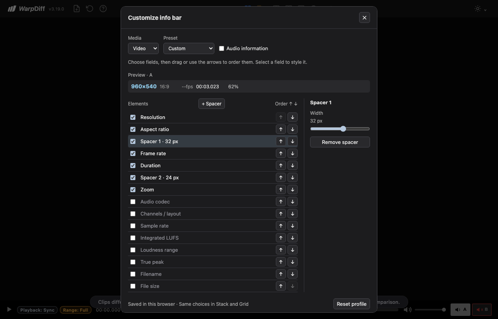

# Info bar editor — implementation and verification

This is the historical implementation record. The subsequent [October 10 review and merge record](../info-bar-review-2026-10-10/README.md) contains the final corrections, engine checks and merge status.

Prepared October 9, 2026 in the existing `codex/shared-scrub` checkout, starting from `f531050b776b38df41f8c2a508452a38cb818747`. Changes are local and uncommitted; this feature has not been published to GitHub Pages. Unrelated existing evidence files were left in place.

## Result and workflow

The earlier interactive sketch lives under `output/info-bar-editor/`; it did not modify the application. This continuation implements the editor in WarpDiff itself, including the requested spacer element. The later [Left/Right and drag continuation](alignment-and-drag.md) records the current section-based editor, removal of arrow buttons, mouse/touch handles, and the correction to the portrait Grid review finding. The verification history below describes the initial implementation; the continuation has its own results.

Open **Customize info bar**, the sliders icon in the header. Choose Images, Video or Audio; each has a separate profile saved in this browser. Start with Default, Minimal, Visual Focus, Audio Essentials or All Available. Changes preview immediately and apply to both Stack and Grid. Reset profile restores only that media type's Default. Default retains the pre-existing display.

Every available metadata field has its own visibility switch and position in Left or Right. Audio information can be switched together or selected individually. Drag handles reorder rows or move them between sections; focused handles also support keyboard movement. Presets place Zoom on the right. Select a field to choose its color, Small (11px), Standard (12px) or Large (14px) text, and bold styling. Filename and file size are optional fields. Slot identity and hide/restore controls keep their existing behavior.

**+ Spacer** inserts a repeatable gap after the selected row in the same section. Gaps can be moved between sections, hidden, removed or resized from 12–48px in 4px steps. Leading/trailing gaps disappear within each section; consecutive gaps, including across hidden or unavailable groups, use the largest requested width. Narrow bars compress gaps, preserve the right suffix, then fit the left prefix; remaining selected fields appear in **More** (**⋯** in compact Grid bars). Hidden fields stay excluded. Customized Stack information moves to its own header row at narrow/tablet widths, and portrait Grid captions retain enough room for their controls.

The modal keeps keyboard input within its controls and returns focus on Escape/close. Preview More remains within the modal's top layer. Browser-storage failures leave changes applied for the current visit and display a persistence warning. Another tab's saved profile updates the current page. Clearing/replacing a comparison retires rendered bars and overflow details without deleting preferences.

## Decisions and implementation

- Separate media profiles avoid carrying picture-only fields into audio comparisons; sharing each profile across Stack/Grid avoids configuring the same metadata twice. Presets provide a starting point, with custom choices retained when late source metadata or loudness results arrive.
- Default uses the original rendering. Custom presentation reads canonical `asset-*` spans and the existing generation-fenced source audio metadata. It does not own playback, decoding, listening graphs or analysis. The source formatter now exposes independent frozen codec/layout/rate strings and per-field details, while preserving the original combined Default label. Multiple tracks are numbered without inferring browser playback selection.
- `js/info-bar.js` owns validated preferences, the editor, custom surfaces and one coalesced refresh/fit path. `_commitInfoBarProfile` is the only persistent writer. Saved content is limited to known field IDs, three text sizes, hex colors, boolean visibility/bold, and at most 24 bounded spacers; it cannot supply selectors, markup or arbitrary CSS. Field and overflow values use `textContent`.
- `__testAPI.infoBarProfiles` returns a cloned snapshot for inspecting active preferences, including the current-visit profile when persistence fails. Tests also check actual saved storage rather than treating an applied UI value as proof of a successful save.
- Selected order also determines overflow priority. Requested spacer widths survive temporary compression. More contains only chosen available fields, and its popup is retired when its source disappears. The existing geometry owner handles measured bar/header changes. Static idle checks found no self-perpetuating refresh loop.
- Custom colors preserve the red above −9 LUFS warning through a separate `!`; Default aspect styling retains the existing nonstandard-aspect amber color. Image wipe retains its pair chooser, and managed host reviews retain their standard display and close the editor on handoff.
- The new classic script is loaded before the inline application script and included in the service-worker assets. App/cache/README versions are aligned at **3.19.0**. The announcement marker advances to 3.19.0 with two short feature bullets; prior details remain in the release archive. README, FEATURES, MANUAL, in-app Manual, Getting Started and the architecture notes were updated. Usage collection and its consent contract were not changed.

## Verification

| Check | Measured result | Evidence |
| --- | --- | --- |
| Structural ownership and pure logic | 520 passed, 0 failed | [Final log](ownership-final.txt) |
| Focused editor browser checks | 14 passed, 0 failed, no retries | [Final focused log](focused-final.txt), [test source](../../tests/info-bar.spec.ts) |
| First full Chromium regression run | 385 passed, 1 existing skipped test | [First full log](full-suite-first.txt) |
| Final full Chromium regression run | 386 passed, 1 existing skipped test, no failures or retries | [Final full log](full-suite-final.txt) |
| Visual and layout checks | Passed at 1280×820, 320×736 with touch, and 736×820 with touch; no sideways dialog/page overflow or runtime errors | [Measurements](ui-verification.json), [visual-check log](ui-final.txt), [reproduction script](verify-ui.mjs) |
| Idle rendering | 1 / 2 / 1 refreshes over 45 display frames for desktop / narrow / tablet, following setup and late metadata/layout publication | [Measurements](ui-verification.json) |
| Syntax and whitespace | `node --check js/info-bar.js` and `git diff --check` passed | Rechecked after final edits |

The focused tests cover Default/reset, preset round trips, order and typography across Stack/Grid, repeated adjustable spacers and collapsed empty groups, per-type persistence, late source/loudness publication, selected-only overflow and clear cleanup, keyboard/focus containment, all-hidden metadata with four-slot controls, cross-tab updates, storage failure, managed host handoff, image wipe, native drag ordering, preview overflow, four-video geometry with large text, and reachable narrow/tablet Stack overflow after resizing.

The full suite's existing skipped timestamp-collision test requires fixtures with near-identical modification times; it is unrelated to this feature. Existing transport, source audio, scrub, listening, scopes, managed-host, appearance and usage checks passed in both full runs.

After the final full run, the read-only profile snapshot and explicit applied-versus-saved assertions were verified by rerunning all 14 focused cases and all 520 ownership/logic checks. The rendered feature behavior was unchanged by that diagnostic addition.

## Failed checks and their resolutions

The initial manual browser check found the native dialog at the top left because the global margin reset overrode its default centering. Adding an explicit `margin: auto` centered it. Presets with spacers were labeled Custom because JSON comparison depended on object property insertion order. Comparing normalized element properties fixed the round trip. [Initial panel](first-panel.png) preserves the early state.

Inspection also found that reusing the combined source-audio tooltip for independent fields would expose deselected codec/rate/layout details. Independent per-field details now accompany independent values. A pure multi-track test and a real-page late-publication test verify that selecting channels does not expose deselected codec/rate information.

The first ownership run had 494 passes and one failure: README still named 3.18.14 after the app/cache bump. Updating the release overview resolved it; the new owner and preference/layout checks bring the final total to 520. See [first ownership log](ownership-first.txt).

The first focused browser run had one pass and ten failures, primarily because my helper counted four permanent slot containers as though only loaded files had containers. The helper now waits for the loaded count. Other setup errors used the first asset-order slot even when it was unloaded, omitted required managed-host display labels, and used the wrong selector for hidden-slot controls. Those were corrected to exercise actual loaded media and the existing host contract. The [second run](focused-second.txt) reached nine passes with two remaining setup failures; the [third run](focused-third.txt) passed all eleven initial cases. Drag/preview overflow and large-text geometry cases then passed in the [fourth run](focused-fourth.txt).

The first visual pass revealed a product issue at narrow/tablet widths: the customized Stack strip could shrink to zero or clip More. The [failed visual record](ui-verification-first.json) retains the hidden-strip timeout and earlier measurements. A dedicated responsive header row fixes the space constraint while the existing geometry observer handles the resulting height. A new resize/More test passes at 736, 320 and 1280px; final visual checks pass for all three viewports.

## Preview images

[Desktop editor](desktop-editor.png) · [Desktop Grid](desktop-grid.png) · [Desktop Stack](desktop-stack.png) · [Narrow editor](narrow-editor.png) · [Narrow Grid](narrow-grid.png) · [Narrow Stack](narrow-stack.png) · [Tablet editor](tablet-editor.png) · [Tablet Grid](tablet-grid.png) · [Tablet Stack](tablet-stack.png)

## Scope and remaining limits

The subsequent [release-readiness review](review.md) found a reproducible narrow Grid issue: four portrait videos could clip More, and short windows could hide it completely. The [Left/Right and drag continuation](alignment-and-drag.md) corrects that issue and records the expanded regression checks. Passing implementation checks are not an independent release review; native Safari and Firefox remain unverified.

Browser verification used real Playwright Chromium. Touch is emulated; this does not establish physical tablet usability. Playwright WebKit was unavailable locally (its browser executable was not installed), so native Safari and Firefox behavior remains unverified. The existing suite's Safari-path tests run in Chromium with platform conditions simulated; they are not native Safari evidence.

Profiles are local to this browser/site, with no account sync or export/import. Text sizes and gap widths are intentionally bounded for the first pass. Image wipe's pair chooser and managed host chrome are outside user customization. Hiding audio information changes presentation; it does not disable audio decoding or original analysis.

Reproduce with the repository's static server on port 8080, `npm run test:ownership`, `npx playwright test tests/info-bar.spec.ts --retries=0`, and `npm test -- --workers=4`. For screenshots and geometry evidence, run `node docs/info-bar-editor-2026-10-09/verify-ui.mjs` from the project root. The local server was left available for review; no commit, push or deployment was performed.
